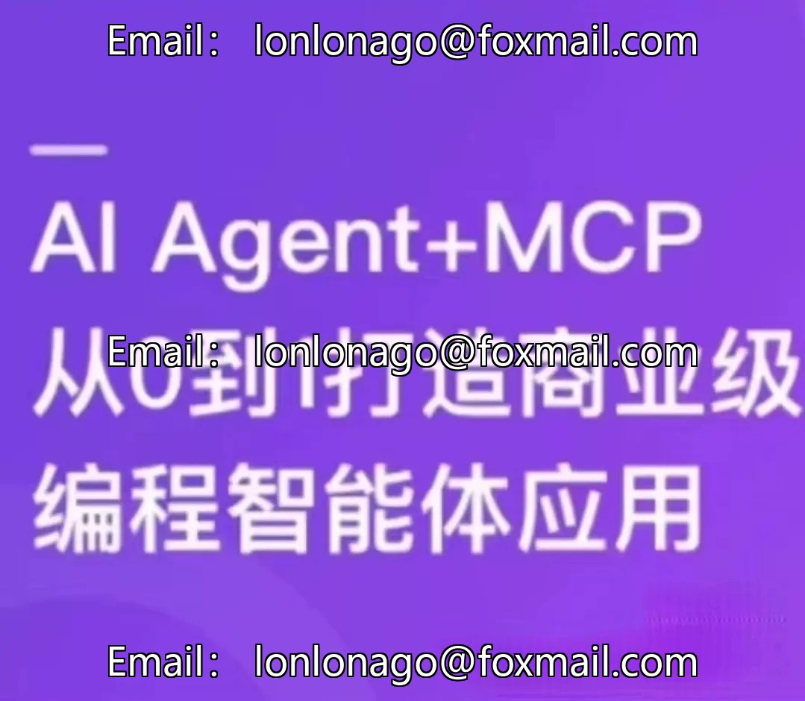
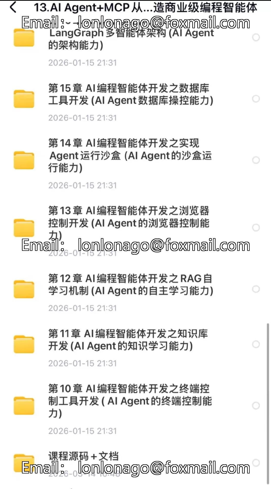
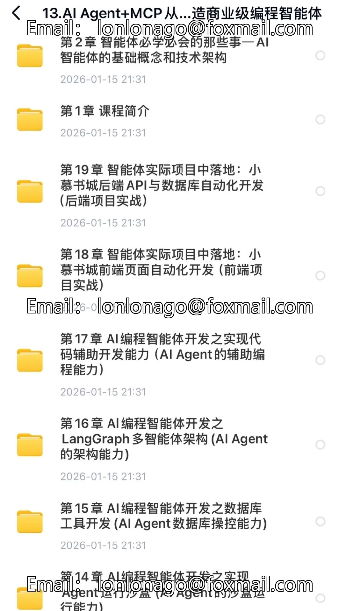
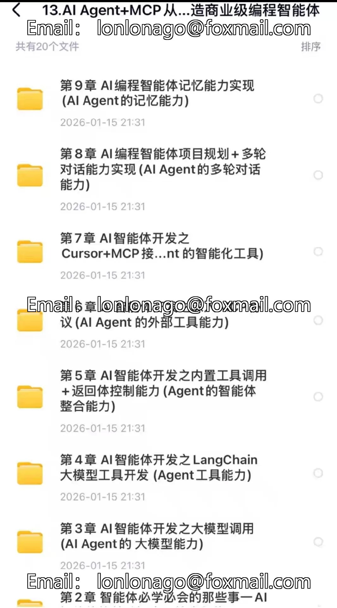

# AI Agent+MCP from 0 to 1 Builds Business-Grade Programming Intelligence

## Body

AI Agent+MCP Builds Commercial-Grade Programming Intelligence from Scratch
LangChain+MCP Practical Course
Latest technology stack, rapid learning within 28 hours, suitable for beginners.

✅ Course Highlights
- LangGraph's Multi-Agent Collaborative Deep Integration
- Practical Development of Over 20 Privately Owned Tools, Automated Frontend and Backend Project Release
- Exclusive MCP protocol teaching, browser control, terminal operations, and enterprise-level applications

Appropriate
- Developers looking to transition into AI development
- Entrepreneurs creating smart products
- Product Managers interested in understanding the technical boundaries

[Plug] [Plug] The product is electronic video materials, with a price! Price! Price!
[Right] [Right] Our store's products are guaranteed to be safe for 24 hours.

## Images

## Payment

Here is a pay link on Stripe ( https://buy.stripe.com/3cs8yP7sY87d0vu9AB ). Please contact me lonlonago@foxmail.com after funding $89, and I will send you a complete data files , thank you!

